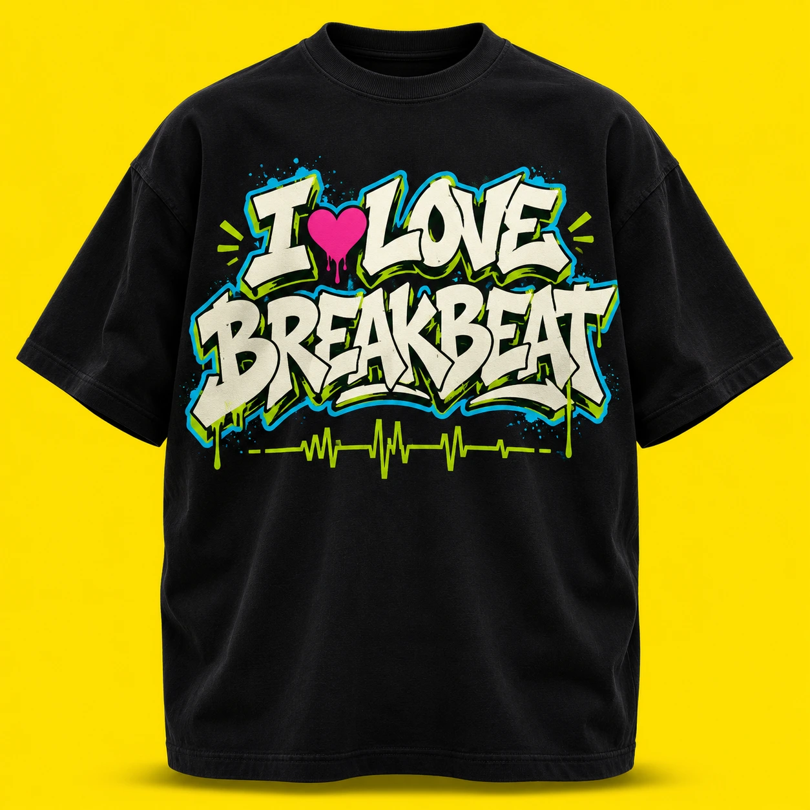
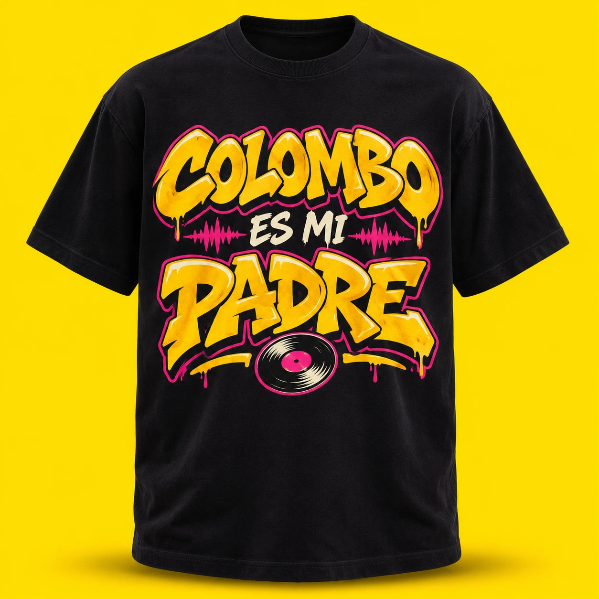
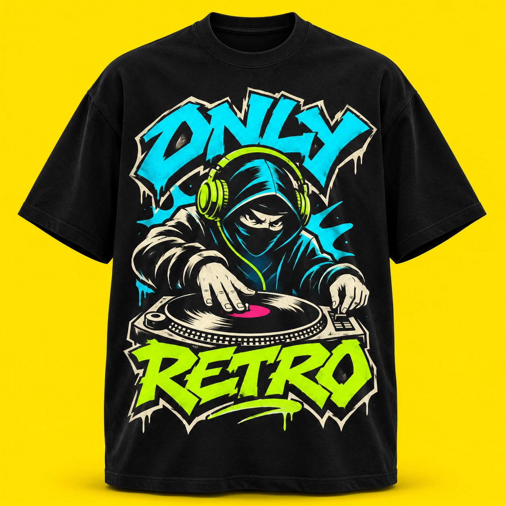
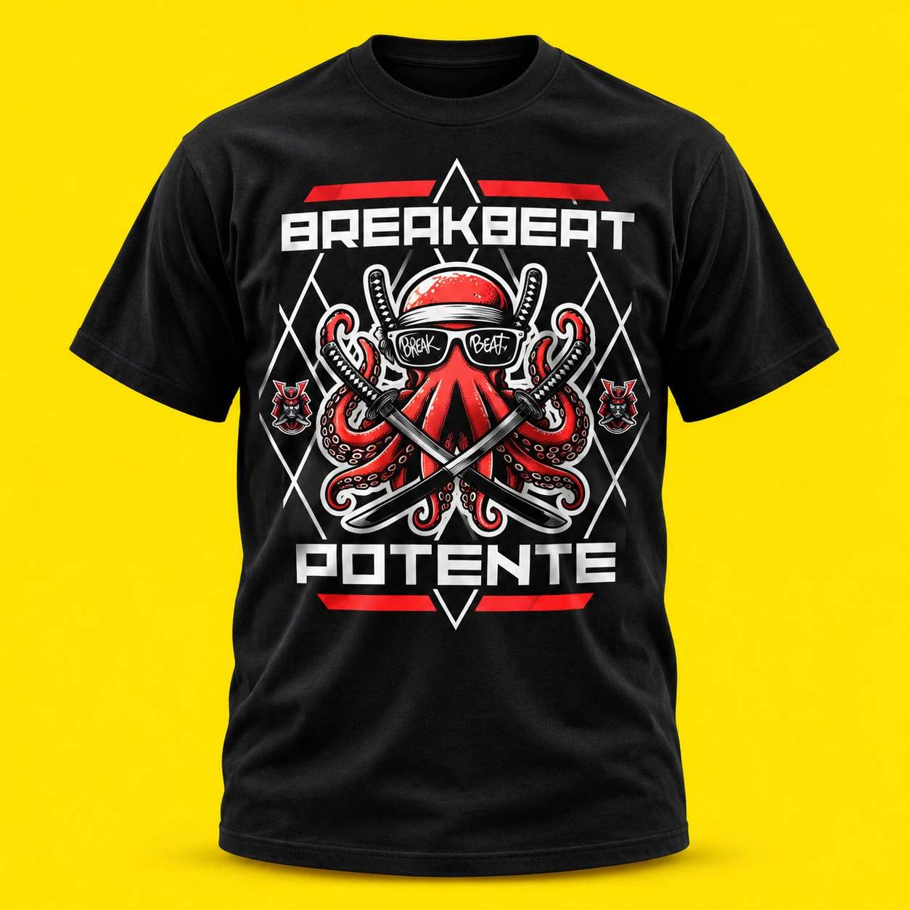
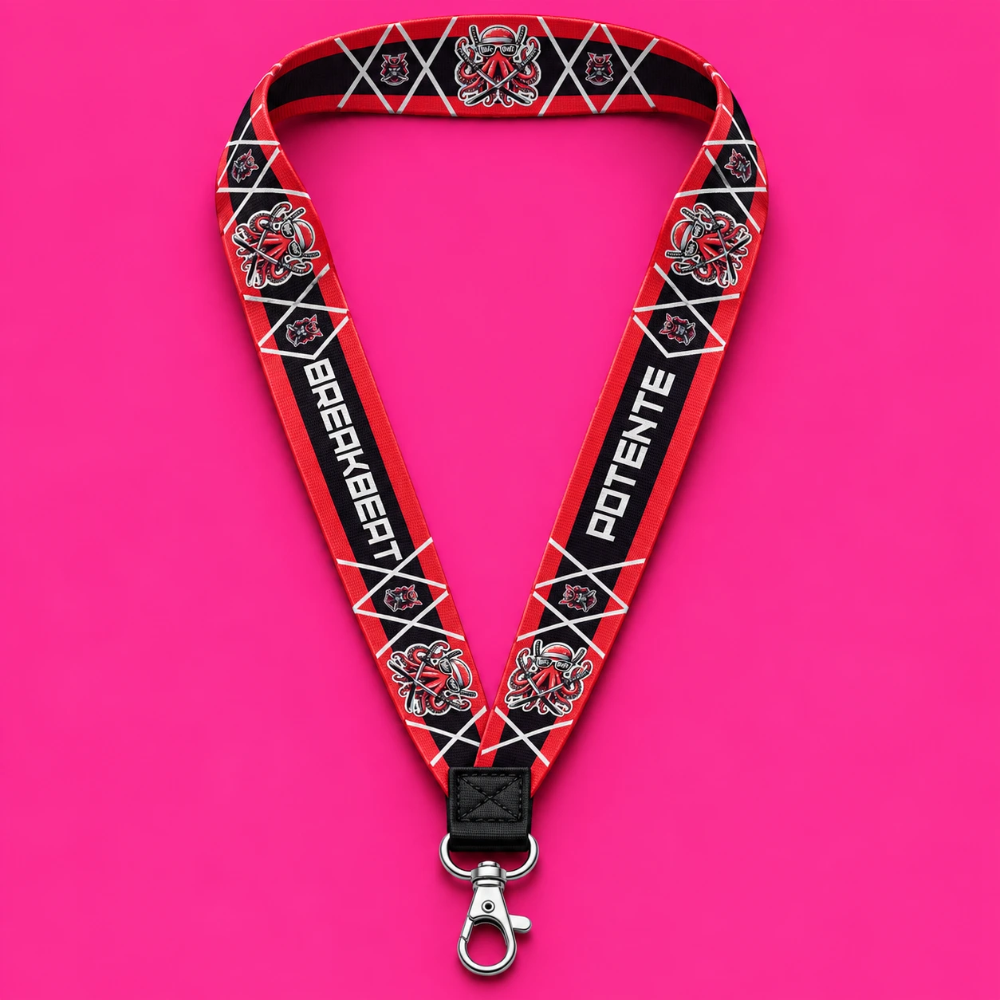

# Breakbeat — propuestas de diseño

Primera exploración visual del nuevo enfoque solicitado el 13 de noviembre de 2026: frases y referencias al género como protagonistas.

Estas cinco imágenes son mockups de catálogo generados con IA e incorporados como nuevos productos. No son artes finales de impresión ni mockups oficiales del fabricante. Las imágenes web están en `public/images/products/`; las referencias originales siguen aquí.

## I LOVE BREAKBEAT

Prompt específico:

> Bold highly readable chest screenprint with exactly 'I LOVE' on the first line and exactly 'BREAKBEAT' on the second. Strong custom graffiti lettering, off-white with acid-green and cyan outlines, a small hot pink heart integrated between the first-line words, and a subtle broken-beat waveform below the word BREAKBEAT. The slogan is the dominant focal point. Clean energetic graphic with intentional negative space.

## COLOMBO ES MI PADRE

Prompt específico:

> Typography-led chest screenprint. The exact Spanish phrase reads 'COLOMBO' on top, 'ES MI' in a smaller middle line, 'PADRE' on the bottom. COLOMBO and PADRE in powerful legible graffiti block lettering, golden yellow #ffd23f ink, off-white highlights, a restrained hot pink outline. A small vinyl record and two short bass waveform accents frame the text. Personal fan slogan aesthetic for the breakbeat DJ, no portrait or official logo. Spell C-O-L-O-M-B-O correctly.

## ONLY RETRO · ninja

Prompt específico:

> Chest illustration of an original masked ninja DJ wearing headphones, eyes visible under a dark hood, hands scratching a vinyl record on a simplified turntable. Strong screenprinted graphic illustration, retro underground breakbeat music aesthetic, confident silhouette, cyan #00e5ff, acid green #b6ff00 and off-white inks, tiny hot pink accent. Exactly 'ONLY' above the ninja and 'RETRO' beneath in highly legible bold angular graffiti lettering. The vinyl, headphones, lettering and ninja form one cohesive compact print. No additional words.

Estilo común: camiseta negra de algodón grueso, foto frontal de estudio con volumen y sin modelo, fondo amarillo #ffe600, formato cuadrado, impresión sobre la tela, graffiti y cultura breakbeat. Textos legibles, sin logotipos oficiales.

## BreakBeat Potente · camiseta

Pulpo rojo con gafas y katanas cruzadas, letras geométricas blancas, pequeños emblemas samurái y trama de rombos. Adaptación vertical del diseño aportado por el usuario sobre camiseta negra, con fondo de colección Summer amarillo.

## BreakBeat Potente · lanyard

Mockup de lanyard de poliéster con mosquetón metálico y estampado rojo, negro y blanco, usando la tira original como referencia. Fondo de colección Retro rosa. La imagen generada es una visualización; el archivo de diseño original permanece sin cambios.

Referencias originales aportadas por el usuario: [tira del lanyard](./breakbeat-concepts/reference-lanyard.png) y [emblema circular](./breakbeat-concepts/reference-emblem.png).

Los cinco diseños aparecen en portada, catálogo, ficha de producto y carrito. Las camisetas se muestran en negro y el lanyard en su combinación roja, negra y blanca. Los productos anteriores mantienen sus opciones y dibujos. Se han usado los precios del catálogo para productos equivalentes: camisetas de frase a 29 €, camisetas de ilustración a 32 € y lanyard a 9 €.

Pendiente: extender la dirección a sudaderas, gorras y más accesorios, y generar variantes de color.

